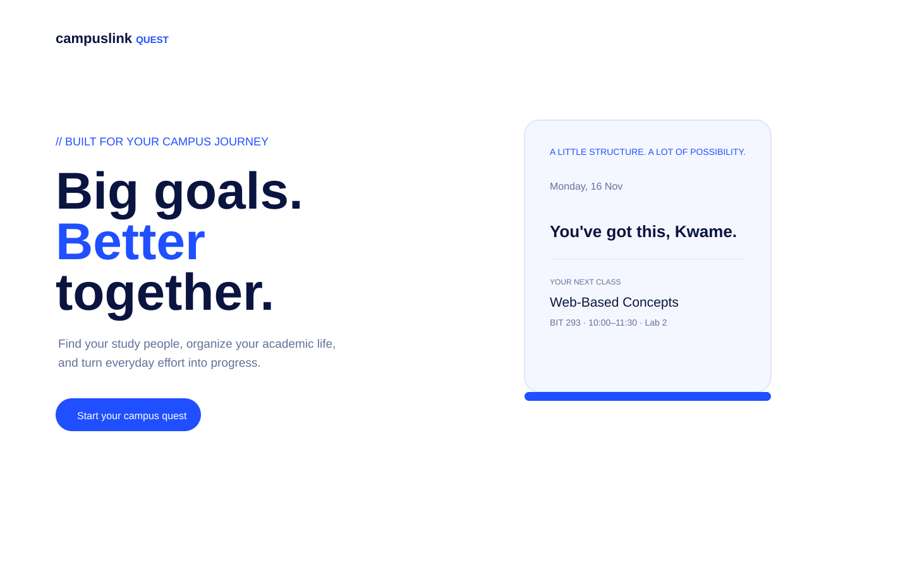
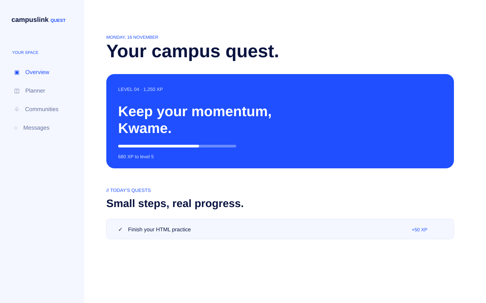
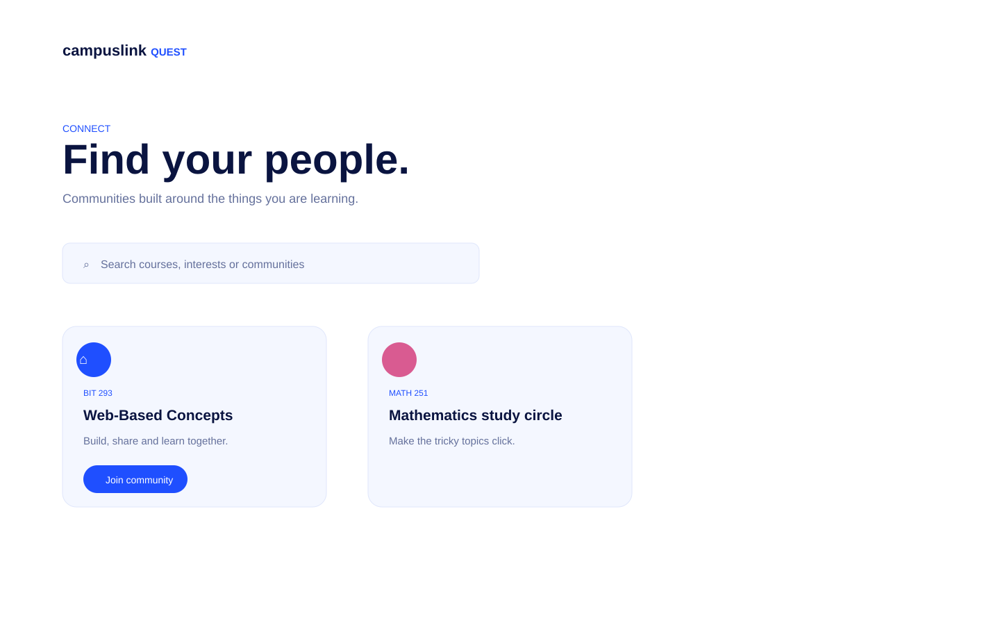

# CampusLink Quest

CampusLink Quest is a React front-end prototype for KNUST students to connect with study communities, organize academic work, and build consistent learning habits.



## Features

- Responsive landing page with light/dark theme toggle.
- Dashboard with XP progress, streaks, and interactive daily quests.
- Searchable communities with join/leave state.
- Weekly planner view with course events.
- Simple messaging panel with local message interaction.
- Mobile navigation for smaller screens.

### Screenshots

#### Student dashboard



#### Communities



The images above are lightweight project screenshots included in the repository so the README renders consistently on GitHub.

## Tech stack

- React 18
- Vite
- JavaScript (ES modules)
- CSS with responsive layouts and CSS custom properties
- Lucide React icons

## Project structure

```text
campuslink-quest/
├── index.html
├── public/
│   └── screenshots/
├── src/
│   ├── App.jsx          # React pages and reusable UI components
│   ├── main.jsx         # React entry point
│   └── styles.css       # Design system and responsive styling
├── package.json
└── README.md
```

## Run locally

```bash
npm install
npm run dev
```

Open the local URL printed by Vite. Create a production build with:

```bash
npm run build
```

## Notes

This is a front-end prototype. Account data, community membership, messages, and planner changes currently live in React state and are not connected to a backend.
